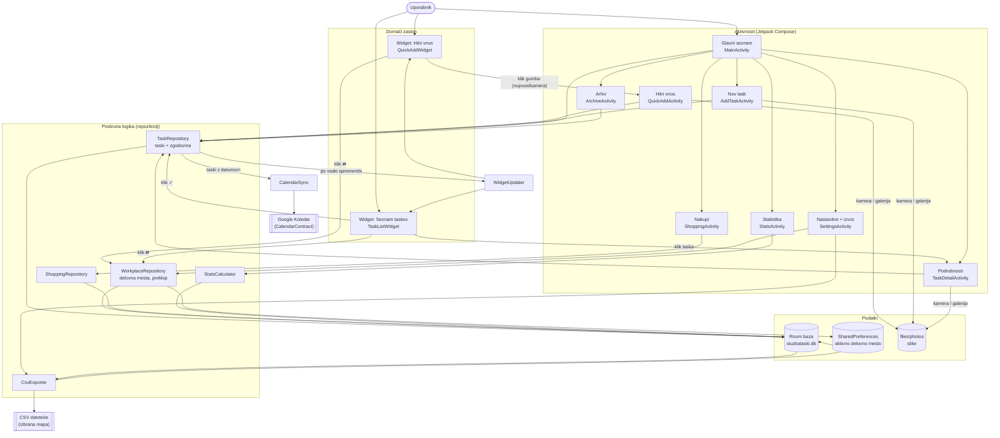
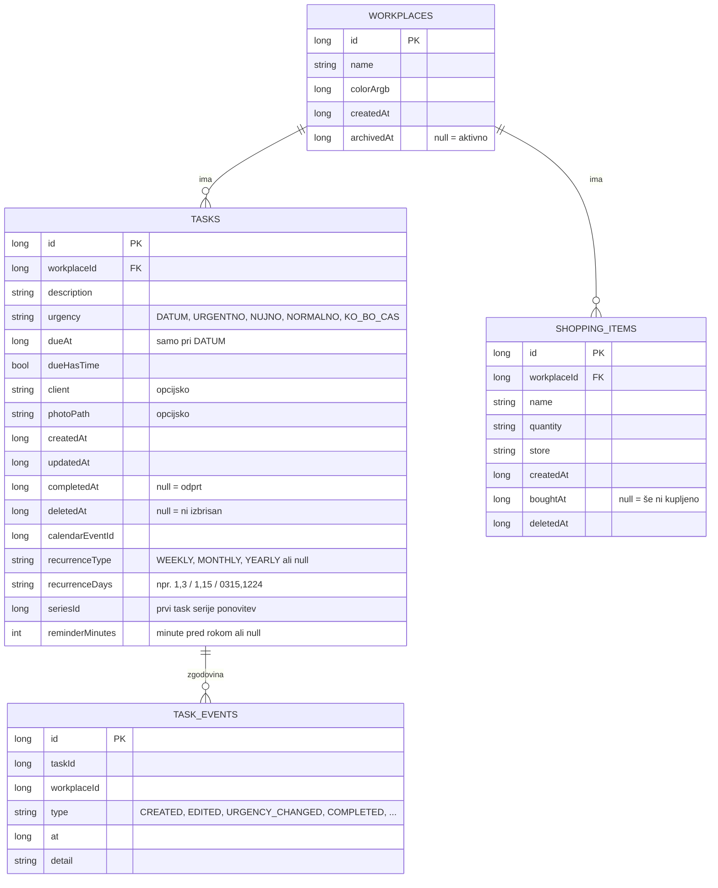
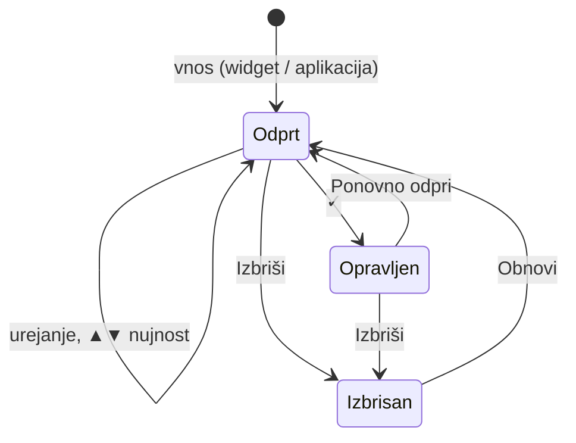
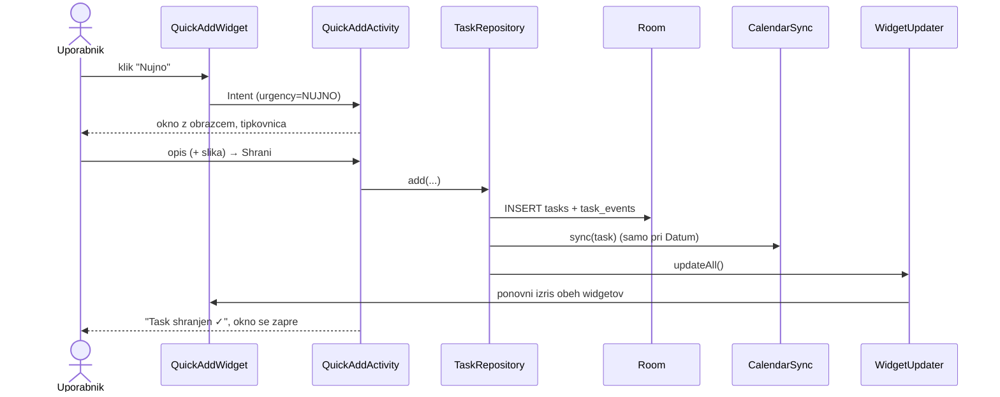
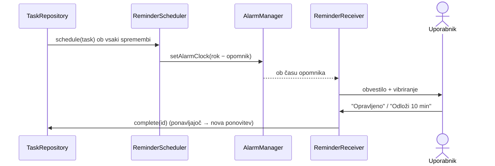

# Arhitektura

## 1. Funkcionalni diagram

Kako se deli aplikacije povezujejo (od uporabnika do podatkov):

## 2. Sloji

| Sloj | Paket | Naloga |
|---|---|---|
| **Predstavitev** | `ui.*`, `widget` | Compose zasloni in Glance widgeti. Ne vsebujejo poslovne logike. |
| **ViewModel** | `*ViewModel` ob vsaki aktivnosti | Pretvori podatke iz repozitorijev v `StateFlow`, preživi zasuk zaslona. |
| **Repozitoriji** | `data.repo` | *Edina* pot do spreminjanja podatkov. Skrbijo za zgodovino, koledar in osvežitev widgetov. |
| **Dostop do podatkov** | `data.dao`, `data.db`, `data.prefs` | Room DAO-ji (SQL), baza, nastavitve. |
| **Storitve** | `calendar`, `photo`, `export`, `stats` | Koledar, slike, CSV izvoz, izračun statistike. |
| **Povezovanje** | `AppGraph` | Ustvari in hrani vse zgornje objekte (preprost service locator). |

Pravilo: **zasloni in widgeti nikoli ne pišejo neposredno v bazo**, vedno gredo prek repozitorija.
Zato se vsaka sprememba zagotovo zapiše v zgodovino, prenese v koledar in prikaže na widgetih.

## 3. Podatkovni model

Vsi časi so v milisekundah od 1. 1. 1970 (epoch). **Nič se ne briše fizično** – "brisanje" le nastavi `deletedAt`.

## 4. Pravilo razvrščanja (TaskSorting)

1. Taski z nujnostjo **Datum** – najbližji (ali zamujeni) rok najprej.
2. **Urgentno → Nujno → Normalno → Ko bo čas.**
3. Znotraj iste skupine: **najstarejši vnos najprej** (kar najdlje čaka, je najvišje).

Isto pravilo uporabljata glavni seznam in widget (`data/repo/TaskSorting.kt`).

## 5. Življenjski cikel taska

Vsak prehod zapiše vrstico v `task_events`.

## 6. Tok: hitri vnos z widgeta

## 7. Google Koledar

Aplikacija uporablja Androidov *Calendar Provider*, ki vsebuje koledarje Google računov na telefonu.
Dogodek, vpisan v koledar Google računa, Android sam sinhronizira z Google Koledarjem, zato ni
potrebna nobena Google prijava ali API ključ. Ciljni koledar je ročno izbran v Nastavitvah ali
(privzeto) koledar z imenom `SluzbaTaski`. Če dovoljenje ob vnosu še ni bilo dano, se task vpiše
ob naslednjem zagonu (`TaskRepository.syncPendingCalendar`). Pred vpisom novega dogodka aplikacija
preveri, ali v koledarju že obstaja dogodek z enakim naslovom in začetkom (npr. po uvozu na nov
telefon z istim Google računom) in ga prevzame, namesto da bi ga podvojila.

## 8. Ponavljajoči taski in opomniki

**Ponavljanje** (`data/repo/Recurrence.kt`): ponavljajoč task ima vedno datum. Ko ga označiš kot
opravljenega, `TaskRepository.complete` izračuna naslednji ustrezen dan (po roku trenutnega, a ne
v preteklosti) in ustvari nov task z enakimi podatki (brez slike), povezan prek `seriesId`.

**Opomniki** (`reminder/`): `ReminderScheduler` nastavi `AlarmManager.setAlarmClock` (točno, kot
budilka) `reminderMinutes` pred rokom (pri tasku brez ure ob 9:00). `ReminderReceiver` pokaže
obvestilo z gumboma *Opravljeno* in *Odloži 10 min* ter vibrira. Alarm se nastavi/prekliče ob vsaki
spremembi taska, `BootReceiver` pa jih po ponovnem zagonu telefona nastavi znova.

## 9. Spreminjanje baze v prihodnosti

Zgodovina verzij: **v1** začetna, **v2** ponavljanje in opomniki (`MIGRATION_1_2`).

Ob spremembi entitete povečaj `version` v `AppDatabase` in dodaj `Migration`. **Nikoli** ne uporabi
`fallbackToDestructiveMigration()` – to bi izbrisalo celotno zgodovino.
