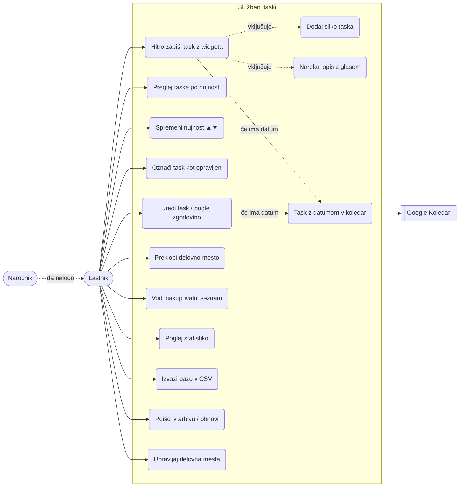

# Uporabniki in primeri uporabe

## Kdo uporablja aplikacijo

Aplikacija je **osebna** – na telefonu jo uporablja ena oseba, podatki ostanejo na telefonu
(razen taskov z datumom, ki gredo v njen Google Koledar, in CSV izvozov, ki jih naredi sama).
Ni prijave, strežnika ali deljenja med uporabniki.

### Akterji

| Akter | Opis | Kako je prisoten v aplikaciji |
|---|---|---|
| **Lastnik (zaposleni)** | Edini neposredni uporabnik. Dela na več delovnih mestih, od različnih ljudi dobiva veliko nalog. | Vnaša, ureja, zaključuje taske, vodi nakupe, gleda statistiko. |
| **Naročnik** | Sodelavec, nadrejeni ali stranka, ki da nalogo. Aplikacije ne uporablja. | Polje *Naročnik* pri tasku; statistika "Naročniki". |
| **Google Koledar** | Zunanji sistem. | Prejme taske z datumom v koledar SluzbaTaski. |
| **Android (sistem)** | Domači zaslon, kamera, prepoznavanje govora, izbira mape. | Gosti widgeta, posname sliko, pretvori govor v besedilo, shrani CSV. |

### Persona

> **Lastnik**, zaposlen na dveh delovnih mestih. Med delom ga ustavljajo ljudje z "lahko še to?".
> Telefona ne želi odklepati in brskati po aplikaciji – nalogo želi zapisati v 5 sekundah
> in se vrniti k delu. Zvečer ali zjutraj pogleda, kaj je nujno, kaj ima rok in koliko je naredil.

## Diagram primerov uporabe

## Primeri uporabe (podrobno)

### UC1 – Hitro zapiši task z widgeta
1. Naročnik ustno da nalogo.
2. Lastnik na domačem zaslonu pritisne gumb nujnosti (npr. **Nujno**) na widgetu *Hitri vnos*.
3. Odpre se okno z izbrano nujnostjo in tipkovnico. Lastnik vpiše opis (ali pritisne 🎤),
   izbere naročnika iz predlogov.
4. **Shrani** → okno se zapre, task je na vrhu ustrezne skupine na widgetu *Seznam taskov*.

Različice: gumb **📷 S sliko** takoj odpre kamero; **📅 Z datumom** takoj odpre izbiro datuma
in task gre tudi v Google Koledar.

### UC4 – Preglej taske
Widget *Seznam taskov* ali glavni zaslon: na vrhu taski z datumom (zamujeni rdeče), nato
Urgentno, Nujno, Normalno, Ko bo čas; znotraj skupine najdlje čakajoči najprej.

### UC6 – Označi kot opravljen
Klik ✓ na widgetu ali v aplikaciji. Task izgine iz seznamov, shrani se čas zaključka in trajanje.
V aplikaciji je mogoča takojšnja razveljavitev.

### UC8 – Preklopi delovno mesto
Klik na ime delovnega mesta (⇄) na kateremkoli widgetu ali izbira v naslovni vrstici aplikacije.
Preklop velja povsod: seznam, widgeti, nakupi, statistika in novi vnosi.

### UC9 – Nakupi
Vpis izdelka (opcijsko količina in trgovina), kljukica ob nakupu. Kupljeno ostane v zgodovini.

### UC10 – Statistika
Izbira obdobja (7 dni … vse). Prikaz števila prejetih in opravljenih, časa izvedbe, zamud,
grafov skozi čas in razdelitev po nujnosti, naročnikih in dnevih.

### UC11 – Izvoz CSV
*Nastavitve → Izvozi v CSV* → izbira mape → nastane mapa `SluzbaTaski_<datum>` s štirimi CSV
datotekami (delovna mesta, taski, zgodovina, nakupi), pripravljenimi za Excel, in podmapo `slike/`
(slika vsakega taska kot `task_<id>.jpg`).
